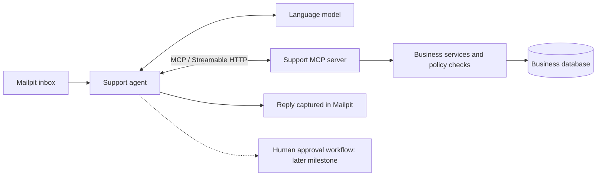

# SupportFlow AI

**An AI-assisted support resolution system built around evidence, controlled actions, and reliable workflows.**

SupportFlow AI is an independent Java and Spring AI portfolio project. It is designed to investigate support emails using business data and policy documents, propose a resolution, and execute permitted actions through a Model Context Protocol (MCP) server.

The first use cases focus on payment and refund support. The aim is to demonstrate both AI integration and the backend engineering needed to make an AI workflow dependable.

> **Status: project foundation.** This repository currently contains documentation and repository conventions. The applications, integrations, tests, and demo described below are planned; there is no runnable application or production deployment yet.

## Initial use cases

| Customer request | Intended behavior |
| --- | --- |
| “I was charged twice.” | Inspect captured payments, distinguish an actual duplicate from legitimate charges, and propose an eligible refund. |
| “Where is my refund?” | Retrieve the recorded refund state and explain it without inventing completion dates. |
| “I want a refund.” | Retrieve the relevant policy, evaluate eligibility in application code, and request approval when required. |

Development and demonstrations will use synthetic customer data, Mailpit for email, and simulated payment operations. A simulated refund must never be presented as a real payment-provider transaction.

## Planned architecture

One repository will contain two independently runnable Spring Boot applications, built together through a Maven parent project.



| Application | Responsibilities | Root package |
| --- | --- | --- |
| `support-agent` | Email ingestion, Spring AI interaction, structured resolution proposals, workflow coordination, and reply delivery. | `io.github.nihar4154.supportflow.agent` |
| `support-mcp-server` | Customer, order, payment, refund, and ticket operations; authorization, transaction boundaries, and business invariants. | `io.github.nihar4154.supportflow.mcp` |

The agent consumes MCP contracts; it does not access business tables or import the MCP server's JPA entities. The two application modules will not depend on each other's executable JARs.

Later milestones will add policy retrieval and durable workflow storage. The agent will own processing and delivery state; the MCP server will own business records and action idempotency. Those responsibilities will remain separate even if local development uses one database instance with separate schemas.

## Design decisions

- **Keep the first implementation small.** Start with two applications, one database, and Mailpit. Add infrastructure only when a specific requirement justifies it.
- **Organize packages by feature.** Keep payment code together and refund code together. Introduce subpackages only when a feature becomes large enough to need them.
- **Keep MCP tool methods thin.** Tool methods validate their input shape and delegate to business services. Services enforce authorization, eligibility, amount limits, transaction ownership, and idempotency independently of model output.
- **Separate AI proposals from execution.** A structured model response is a proposal, not proof that an action is authorized or completed.
- **Use the appropriate source of evidence.** Query tools supply current business facts. RAG will supply versioned policy passages with citations. Enforce financial rules in code.
- **Record state explicitly.** Persisted workflow state will support approval, clarification, retries, and escalation. Mail read/unread flags and chat memory will not be the durable workflow record.
- **Make outcomes observable.** Track execution status, tool results, policy references, and delivery attempts. Customer replies must reflect confirmed outcomes.

For example, a refund will follow this boundary:

```text
RefundTools -> RefundService -> RefundRepository
                    |
                    +-> RefundPolicy
```

`RefundService` will check ownership, available refundable balance, approval requirements, and duplicate execution before performing a simulated action.

## Repository layout

The initial commit contains:

```text
supportflow-ai/
├── README.md
├── .gitignore
└── .editorconfig
```

The application scaffold will introduce the following layout incrementally. These directories and build files do not exist yet.

```text
supportflow-ai/
├── pom.xml                         # Parent/aggregator: supportflow-parent
├── mvnw / mvnw.cmd / .mvn/          # Maven wrapper
├── support-agent/
│   ├── pom.xml
│   ├── Dockerfile
│   └── src/
│       ├── main/java/io/github/nihar4154/supportflow/agent/
│       │   ├── SupportAgentApplication.java
│       │   ├── config/
│       │   ├── email/
│       │   ├── resolution/
│       │   └── demo/
│       ├── main/resources/
│       │   ├── application.yml
│       │   └── prompts/support-resolution-system.st
│       └── test/                   # Matching packages and evaluation fixtures
├── support-mcp-server/
│   ├── pom.xml
│   ├── Dockerfile
│   └── src/
│       ├── main/java/io/github/nihar4154/supportflow/mcp/
│       │   ├── SupportMcpServerApplication.java
│       │   ├── customer/
│       │   ├── order/
│       │   ├── payment/
│       │   ├── refund/
│       │   └── ticket/
│       ├── main/resources/
│       │   ├── application.yml
│       │   └── db/migration/
│       └── test/
├── compose.yaml
├── .env.example
├── demo/                           # Repeatable requests and synthetic emails
├── docs/                           # Architecture decisions and demo instructions
└── .github/workflows/ci.yml
```

Each application's main class will sit at the root of its package hierarchy. A typical feature will contain its entity, repository, service, tool adapter, and explicit request/result types. Avoid creating empty layers or a shared `common` module without a demonstrated need.

## Naming and code conventions

| Element | Convention | Example |
| --- | --- | --- |
| Maven group ID | Stable project namespace | `io.github.nihar4154.supportflow` |
| Parent artifact ID | Project parent | `supportflow-parent` |
| Application artifact IDs | Lowercase, hyphen-separated | `support-agent`, `support-mcp-server` |
| Java packages | Lowercase feature names | `payment`, `refund`, `resolution` |
| Classes and records | PascalCase, named by responsibility | `RefundService`, `ResolutionResult` |
| Methods and fields | camelCase | `detectDuplicateCharges`, `orderNumber` |
| Enum constants | UPPER_SNAKE_CASE | `PENDING_APPROVAL` |
| MCP tools | snake_case, precise action names | `get_order_details`, `request_refund` |
| Database objects | snake_case | `support_tickets`, `customer_id` |
| Configuration keys | kebab-case | `supportflow.inbox.poll-interval` |

Use constructor injection, explicit DTOs at boundaries, and `BigDecimal` for monetary amounts. Keep exceptions meaningful and place tests beside the corresponding package structure. Avoid generic `Manager`/`Utils` classes and interfaces with a single implementation unless they define a useful boundary.

## Planned stack

- Java, Spring Boot, and Maven.
- Spring AI for model integration, structured responses, MCP client/server support, and later RAG.
- Spring Data JPA, MySQL, and Flyway for business persistence and schema migrations.
- Mailpit and Docker Compose for reproducible local demonstrations.
- JUnit, Spring Boot tests, and Testcontainers for automated verification.
- Spring Boot Actuator and Micrometer for operational telemetry.

Compatible Java, Spring Boot, and Spring AI versions will be selected and pinned in the scaffold milestone. Build and container versions will be recorded in the repository; release choices will not be inferred from the tutorial's branch name.

## Implementation milestones

- [x] Define scope, architecture, package names, and repository conventions.
- [ ] **1. Scaffold and business foundation:** add the Maven modules, local infrastructure, migrations, synthetic data, and tested customer/order/payment services.
- [ ] **2. First end-to-end workflow:** read an email, investigate through read-only MCP tools, return a structured resolution, and capture the reply in Mailpit.
- [ ] **3. Policy-grounded proposals:** add policy ingestion, retrieval, citations, and explicit clarification/escalation outcomes when evidence is insufficient.
- [ ] **4. Controlled actions:** add simulated refunds, authenticated authorization, human approval, and durable approval records tied to the exact proposed action.
- [ ] **5. Recovery and delivery:** persist workflow progress, enforce action idempotency, bound retries, and retry email delivery without repeating completed actions.
- [ ] **6. Interview demonstration:** add CI, containerized startup, evaluation results, observability, and a recorded walkthrough with reproducible scenarios.

## Verification and demo goals

The evaluation set will begin with 30–50 reviewed synthetic cases. It will cover successful resolutions, ambiguous requests, missing records, unauthorized access, misleading email instructions, policy conflicts, and dependency failures.

Deterministic tests will verify business invariants and resulting database state. Model-assisted evaluation may supplement human review for answer quality; it will not determine whether money or authorization checks are correct.

The finished demo should show:

1. A grounded answer to a payment or refund question.
2. A refund proposal awaiting approval, with evidence and a clear action summary.
3. A request for another customer's records rejected by the business service.
4. A restart after a simulated refund that resumes reply delivery without a second refund.
5. Missing evidence or a tool failure producing clarification or escalation instead of a fabricated success.

Report measured decision correctness, citation support, unauthorized-action attempts blocked, duplicate actions, latency, and token usage with the dataset, model, prompt version, and test conditions. No performance results are claimed at this stage.

## Running the project

There are no build or run commands yet because application code has not been added. The scaffold milestone will provide tested setup instructions, an `.env.example` containing placeholders, and local demo commands.

Secrets and real customer information must not be committed. Demo endpoints and synthetic seed data will be enabled explicitly through a demo profile. Model credentials will be supplied through the environment or a secret manager.

## Learning approach and reference

This project is inspired by the [Eazy Bytes Spring AI support-agent example](https://github.com/eazybytes/spring-ai/tree/2.x/section_11/support-agent-demo). It will be implemented independently, feature by feature, with documented design decisions and tests. No tutorial application source is included in this initial commit.

Useful references:

- [Spring Boot project structure](https://docs.spring.io/spring-boot/reference/using/structuring-your-code.html)
- [Spring AI MCP support](https://docs.spring.io/spring-ai/reference/api/mcp/mcp-overview.html)
- [Spring AI retrieval-augmented generation](https://docs.spring.io/spring-ai/reference/api/retrieval-augmented-generation.html)
- [Spring AI evaluation testing](https://docs.spring.io/spring-ai/reference/api/testing.html)

The goal is to explain and demonstrate every design decision, including what the system cannot safely automate.
