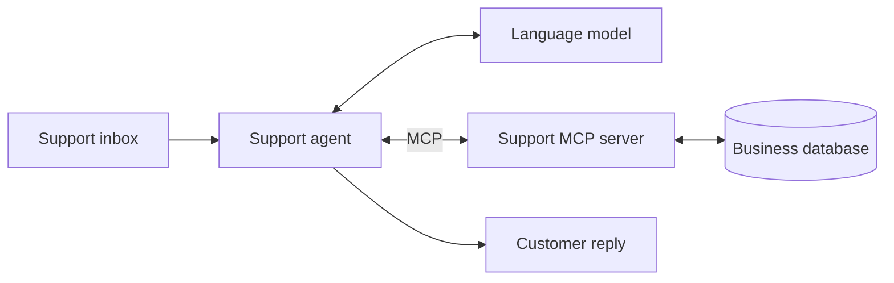
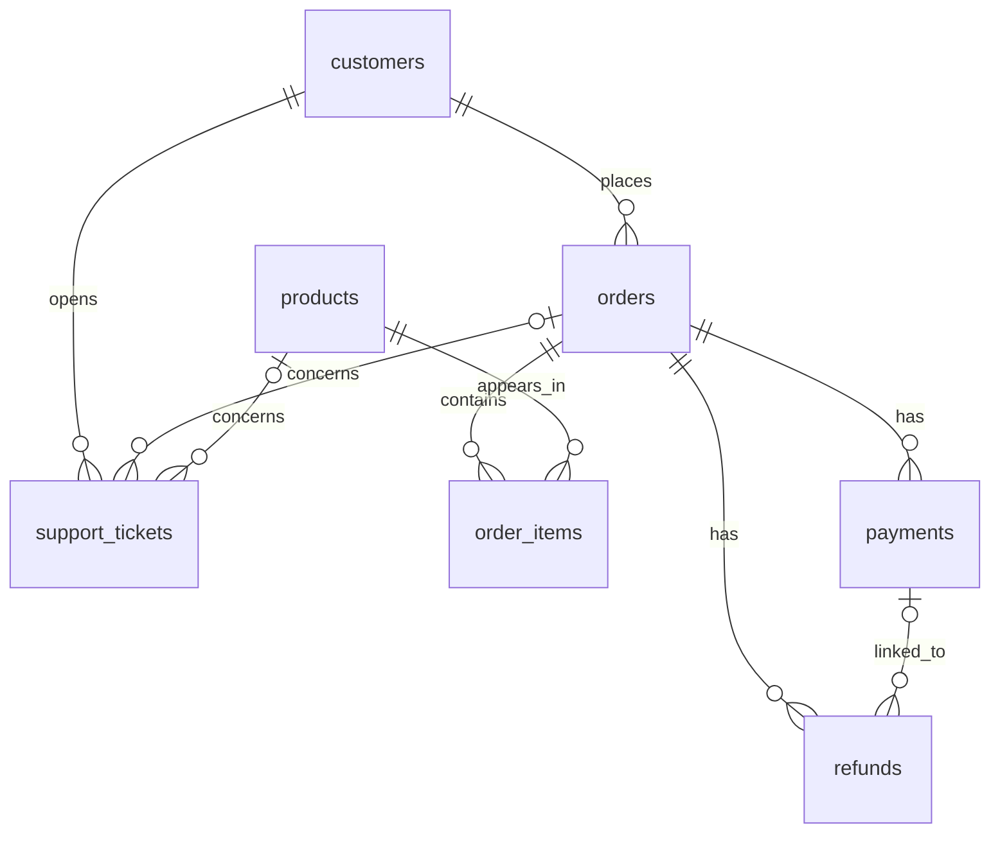

# SupportFlow AI

AI-assisted customer support for payment and refund queries, built with Java, Spring Boot, and Spring AI.

SupportFlow AI is designed to read support emails, investigate customer issues using business data, and prepare clear, accurate replies. Actions such as refunds follow business rules and approval requirements, with a record of what was decided and done.

> **In development:** the architecture and roadmap are defined. Application implementation is the next step.

## What it will do

The first release will focus on three common requests:

| Request | Response |
| --- | --- |
| “I was charged twice.” | Check payment records, identify duplicate charges, and propose an eligible refund. |
| “Where is my refund?” | Look up the refund status and explain its progress. |
| “I want a refund.” | Review the applicable policy, check eligibility, and request approval when needed. |

When information is missing or a case needs human judgment, the agent will ask for clarification or escalate it.

## How it works

1. **Receive** a customer email.
2. **Investigate** using customer, order, and payment records.
3. **Consult** relevant support policies and include supporting references.
4. **Resolve** the request or propose an action for approval.
5. **Reply** to the customer and record the outcome.

The planned architecture separates the AI workflow from business operations:



**`support-agent`** will handle email processing, model interaction, policy retrieval, and reply delivery.

**`support-mcp-server`** will expose business operations through the Model Context Protocol (MCP). Its services will enforce access controls, refund rules, and duplicate-action checks.

The model will propose actions; application code will determine whether they are allowed. Saved workflow progress will let failed steps resume without repeating completed refunds.

## Technology

| Area | Planned stack |
| --- | --- |
| Application | Java, Spring Boot, Gradle |
| AI integration | Spring AI, MCP, retrieval-augmented generation (RAG) |
| Data | MySQL schema and sample data; Spring Data JPA and migrations planned |
| Local environment | Docker Compose, Mailpit |
| Testing and monitoring | JUnit, Testcontainers, Spring Boot Actuator, Micrometer |

## Project structure

The applications currently have separate Gradle builds and will run independently:

```text
supportflow-ai/
├── support-agent/        # Email processing and AI workflow
├── support-mcp-server/   # Business services and MCP tools
├── demo/                 # Sample emails and repeatable scenarios
├── docs/                 # Architecture and setup guides
├── support-agent/build.gradle.kts
└── support-mcp-server/compose.yaml  # Local MySQL
```

Java packages will use the root `io.github.nihar4154.supportflow`, with `agent` and `mcp` branches. Within each application, code will be grouped by feature, such as `email`, `payment`, and `refund`.

## Database relationships

The [schema](support-mcp-server/db/init/01-schema.sql) and [sample data](support-mcp-server/db/init/02-seed.sql) define the `supportflow` MySQL database. The sample records cover repeat product issues and a duplicate charge. These scripts run in filename order when MySQL initializes a **new** data volume; they do not rerun on every application start.

During development, the MCP server starts MySQL through Docker Compose and leaves it running when the application stops. Start the app with `cd support-mcp-server && ./gradlew bootRun`, or run its main class in IntelliJ with the repository root as the working directory. Docker Desktop must be running. MySQL is exposed on `localhost:3306`. To use a different working directory when running the main class, set `SUPPORTFLOW_COMPOSE_FILE` to the path of `support-mcp-server/compose.yaml`. Spring Boot's Compose service connection takes precedence over datasource environment variables while Compose integration is enabled; set `spring.docker.compose.enabled=false` when connecting to another database.



Each order belongs to one customer. `order_items` links orders to products and records the quantity and price paid. An order can have several payment attempts or captured charges, which lets the demo represent a duplicate charge. Each refund belongs to an order and may reference a specific payment. Every support ticket belongs to a customer; its order and product references are optional.

Foreign keys ensure referenced rows exist. Business rules still need application checks: a refund's payment must belong to the same order, the refundable amount must be valid, and a ticket's order must belong to its customer. These checks are not implemented yet.

## Roadmap

- [x] Define the project scope and architecture.
- [ ] Set up both applications, the database, and local email delivery.
- [ ] Complete an email-to-reply workflow using read-only MCP tools.
- [ ] Add policy retrieval with supporting references.
- [ ] Introduce refund approvals and simulated refund execution.
- [ ] Add persistent workflows, retries, and protection against duplicate actions.
- [ ] Publish automated evaluations, monitoring, and a reproducible demo.

## Demo and evaluation

The demo will use synthetic customer data, Mailpit for email, and simulated payments. It will cover successful resolutions, missing information, unauthorized requests, and recovery after a failure.

Evaluation will measure whether decisions are correct, replies are supported by evidence, and actions respect permissions. Latency and model usage will also be recorded.

Setup instructions will be added with the first runnable version.

## Local monitoring and tracing

From the repository root, start the monitoring stack before starting or restarting the two Java applications on the host.

```sh
docker compose -f observability/compose.yaml up -d
```

Open [Prometheus targets](http://localhost:9090/targets) and check that both applications are UP. Prometheus scrapes their Actuator endpoints every ten seconds. Open the [SupportFlow email dashboard](http://localhost:3000/d/supportflow-email) in Grafana (initial local login `admin` / `admin`). It shows scrape health, cumulative email attempts by outcome, and recent mean processing times. Email metrics appear after a message has been handled. Duration averages require traffic during the five-minute window.

Send a demo email, then open [Jaeger](http://localhost:16686), select `support-agent`, and search for `support.email.handle`. Each handling attempt includes resolution and reply stages as reached. The agent console includes the active trace ID. In Grafana Explore, choose the Jaeger datasource to look up that ID. A skipped reply means the mail sender found no usable recipient or reply body. A failed attempt returns the email to the existing retry path.

The local configuration samples all traces. Override `MANAGEMENT_TRACING_SAMPLING_PROBABILITY` and `MANAGEMENT_OPENTELEMETRY_TRACING_EXPORT_OTLP_ENDPOINT` for other environments. Jaeger keeps local traces in memory. Stop the monitoring containers with `docker compose -f observability/compose.yaml down`.

The Runtime logs panel displays application output collected by Alloy from `~/.supportflow/logs` and stored in Loki. Restart each Java app after enabling file logging. In Grafana Explore select Loki and query `{service_name="support-agent"} |= "Handing email"` to find processing attempts.

Both services emit newline-delimited Logstash JSON to the console and log file. Events inside a traced operation include Micrometer’s `traceId` and `spanId`. In Grafana Explore, expand an event and choose **Open in Jaeger**. To filter by trace, use `{service_name=~"support-agent|support-mcp-server"} | json | traceId="<trace ID>"`.
