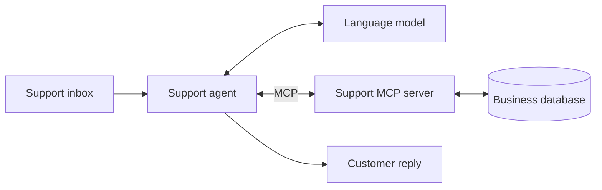

# SupportFlow AI

AI-assisted customer support for payment and refund queries, built with Java, Spring Boot, and Spring AI.

SupportFlow AI is designed to read support emails, investigate customer issues using business data, and prepare clear, accurate replies. Actions such as refunds follow business rules and approval requirements, with a record of what was decided and done.

> **In development:** the architecture and roadmap are defined. Application implementation is the next step.

## What it will do

The first release will focus on three common requests:

| Request | Response |
| --- | --- |
| “I was charged twice.” | Check payment records, identify duplicate charges, and propose an eligible refund. |
| “Where is my refund?” | Look up the refund status and explain its progress. |
| “I want a refund.” | Review the applicable policy, check eligibility, and request approval when needed. |

When information is missing or a case needs human judgment, the agent will ask for clarification or escalate it.

## How it works

1. **Receive** a customer email.
2. **Investigate** using customer, order, and payment records.
3. **Consult** relevant support policies and include supporting references.
4. **Resolve** the request or propose an action for approval.
5. **Reply** to the customer and record the outcome.

The planned architecture separates the AI workflow from business operations:



**`support-agent`** will handle email processing, model interaction, policy retrieval, and reply delivery.

**`support-mcp-server`** will expose business operations through the Model Context Protocol (MCP). Its services will enforce access controls, refund rules, and duplicate-action checks.

The model will propose actions; application code will determine whether they are allowed. Saved workflow progress will let failed steps resume without repeating completed refunds.

## Technology

| Area | Planned stack |
| --- | --- |
| Application | Java, Spring Boot, Maven |
| AI integration | Spring AI, MCP, retrieval-augmented generation (RAG) |
| Data | MySQL, Spring Data JPA, Flyway |
| Local environment | Docker Compose, Mailpit |
| Testing and monitoring | JUnit, Testcontainers, Spring Boot Actuator, Micrometer |

## Project structure

The applications will share a Maven parent build and run independently. This layout will be added as implementation progresses:

```text
supportflow-ai/
├── support-agent/        # Email processing and AI workflow
├── support-mcp-server/   # Business services and MCP tools
├── demo/                 # Sample emails and repeatable scenarios
├── docs/                 # Architecture and setup guides
├── pom.xml               # Parent Maven build
└── compose.yaml          # Local infrastructure
```

Java packages will use the root `io.github.nihar4154.supportflow`, with `agent` and `mcp` branches. Within each application, code will be grouped by feature, such as `email`, `payment`, and `refund`.

## Roadmap

- [x] Define the project scope and architecture.
- [ ] Set up both applications, the database, and local email delivery.
- [ ] Complete an email-to-reply workflow using read-only MCP tools.
- [ ] Add policy retrieval with supporting references.
- [ ] Introduce refund approvals and simulated refund execution.
- [ ] Add persistent workflows, retries, and protection against duplicate actions.
- [ ] Publish automated evaluations, monitoring, and a reproducible demo.

## Demo and evaluation

The demo will use synthetic customer data, Mailpit for email, and simulated payments. It will cover successful resolutions, missing information, unauthorized requests, and recovery after a failure.

Evaluation will measure whether decisions are correct, replies are supported by evidence, and actions respect permissions. Latency and model usage will also be recorded.

Setup instructions will be added with the first runnable version.
